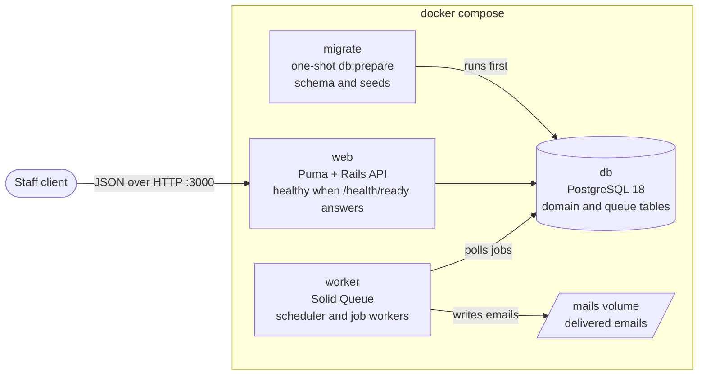
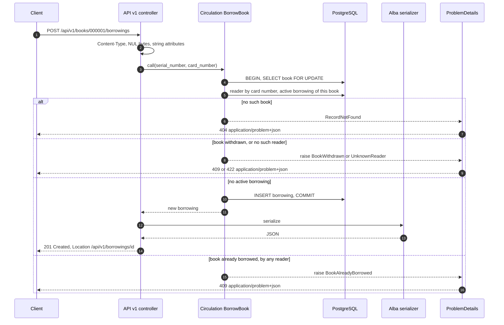
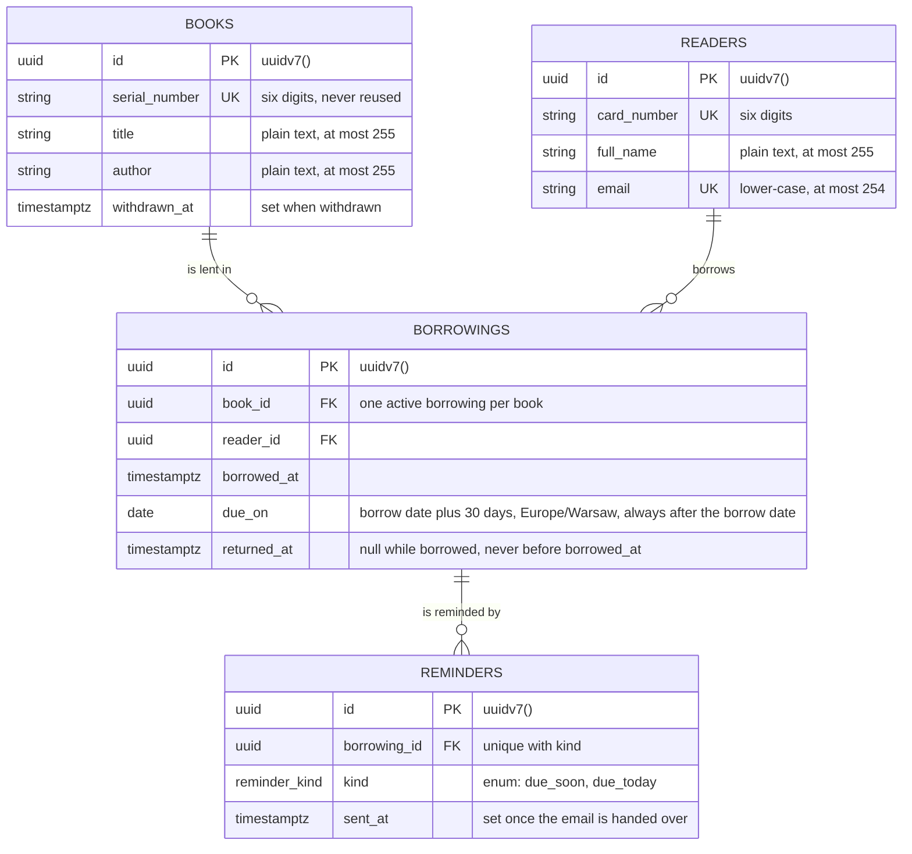
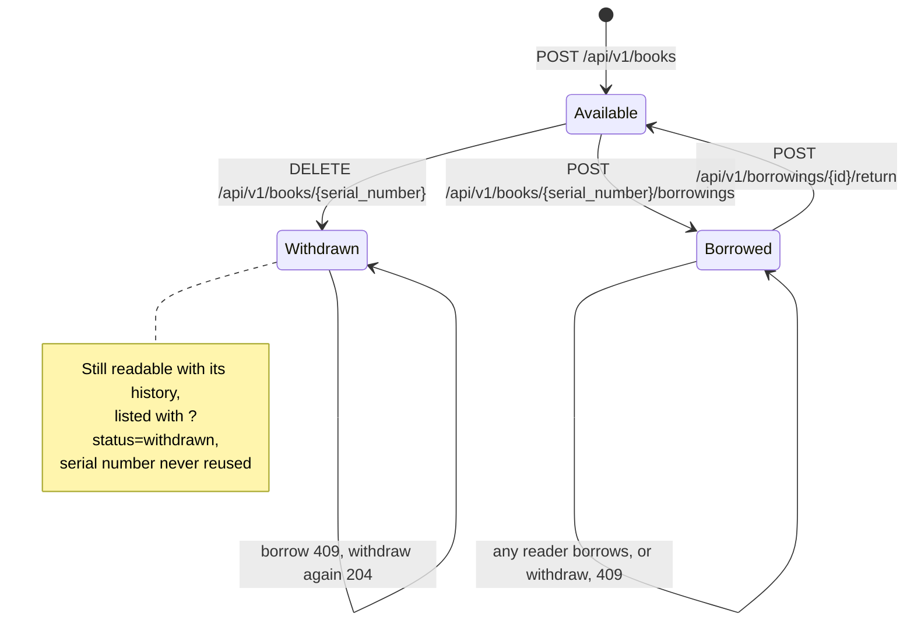
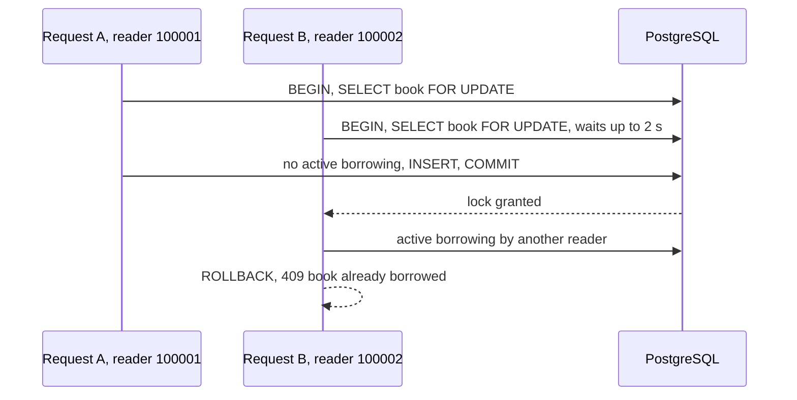
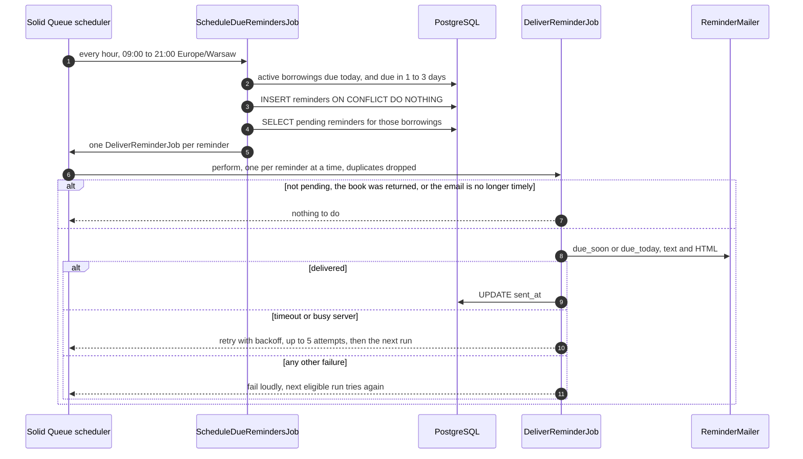

# Diagrams

How the Bookcase API fits together. The [README](../README.md) explains the decisions; the interactive API reference is served at <http://localhost:3000/docs>.

- [Services](#services)
- [A request through the code](#a-request-through-the-code)
- [Data model](#data-model)
- [Book states](#book-states)
- [Two staff members borrow the same book](#two-staff-members-borrow-the-same-book)
- [Reminder emails](#reminder-emails)

## Services

What `docker compose up` starts. `web` and `worker` wait for `migrate`, which waits for a healthy database. Only `127.0.0.1` can reach the published ports. The `mails` volume is mounted in every app container, so `docker compose exec web cat tmp/mails/*` shows what the worker wrote.

## A request through the code

Controllers only translate HTTP. Commands change state inside a transaction and raise typed domain errors, and one concern turns every error into a problem document.

## Data model

A borrowing links a book to a reader. A book is borrowed while it has a borrowing with no `returned_at`; withdrawn books keep their history. Reminders record which emails went out and remain pending until delivery succeeds.

## Book states

Each transition is one endpoint. Borrowing an already borrowed book answers 409, including for the same reader. Repeated returns and withdrawals change nothing.

## Two staff members borrow the same book

The book row is locked before the check, so the second request waits for the first to commit and then sees the borrowing. A wait longer than the 2 s lock timeout answers `503` with `Retry-After`. A partial unique index independently prevents two active borrowings of the same book; it does not constrain historical intervals.

## Reminder emails

The scheduler runs every hour from 09:00 to 21:00 Europe/Warsaw. Each reminder is a row, unique per borrowing and kind. Every run queues pending reminders still within their delivery window. A reminder marked sent is not queued again. A crash after sending but before recording success can cause a duplicate email; an outage beyond the window can cause a missed email.

